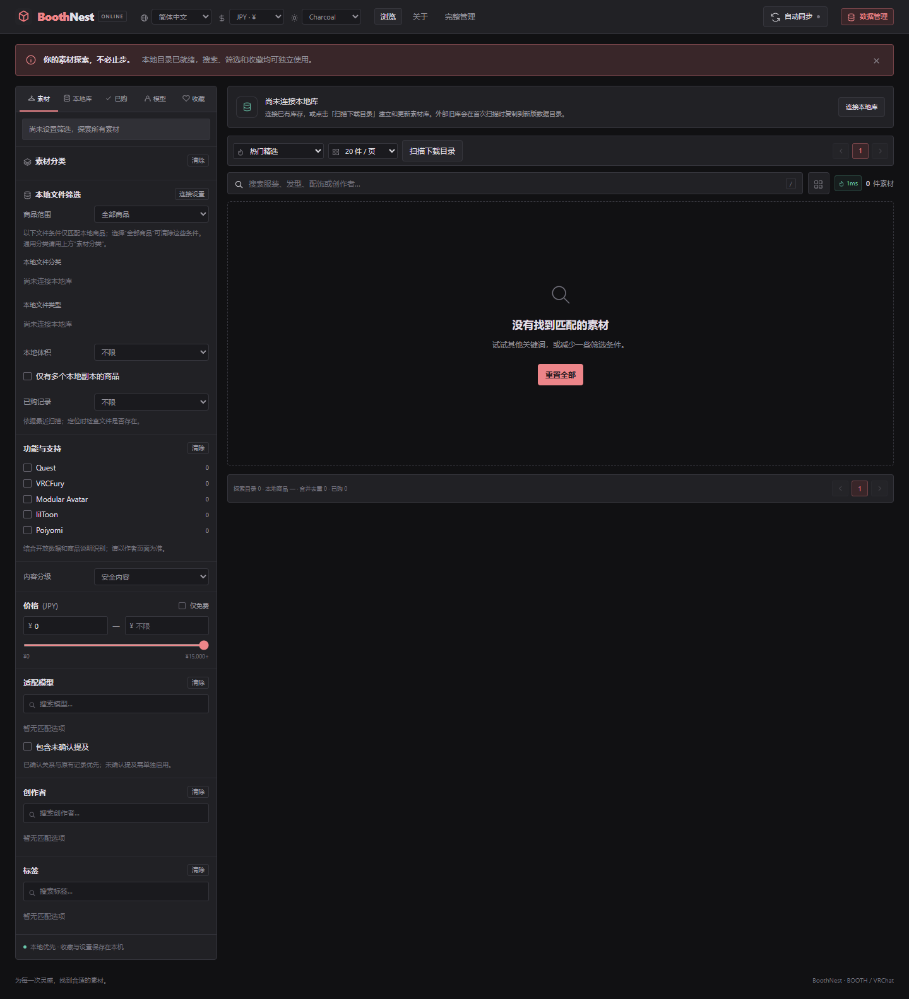
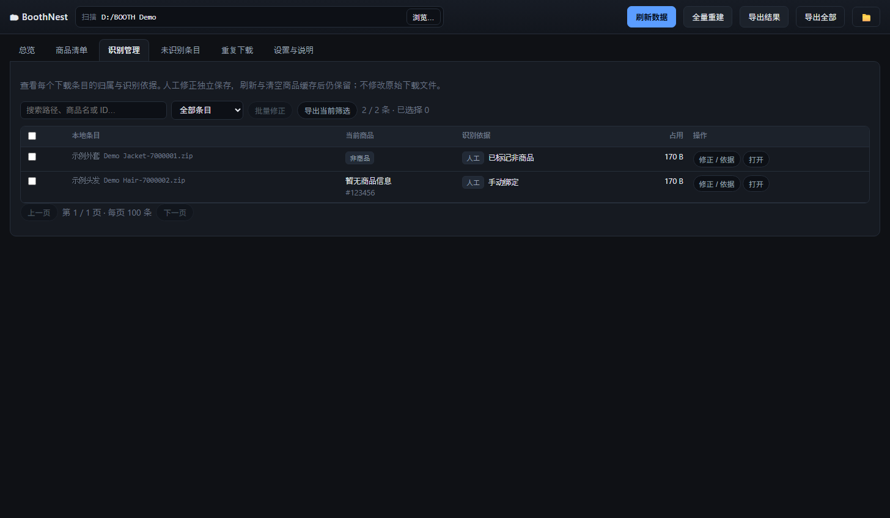
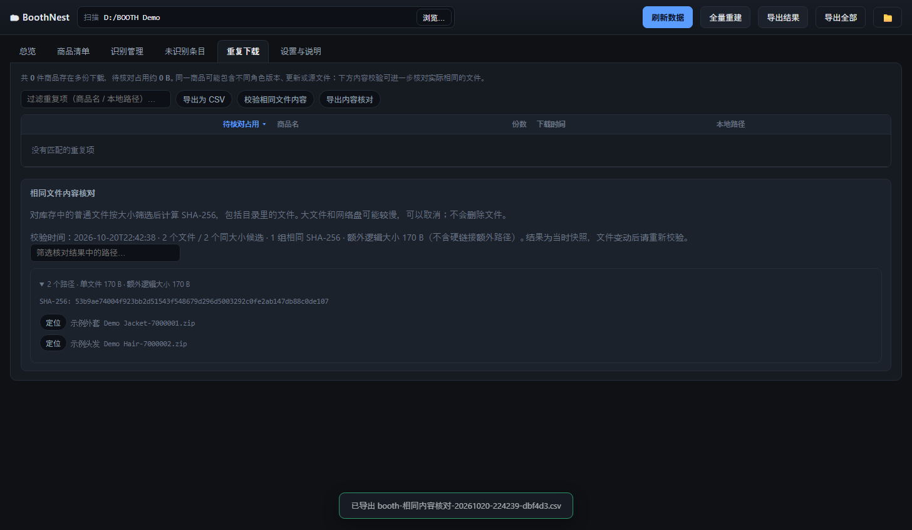

# BoothNest

通过图形界面浏览、搜索和管理自己的 BOOTH 下载库，提供新版网站和 Windows 桌面版。新版网站可在本机运行，也可部署到 fnOS / Docker 后通过浏览器访问。

[](https://github.com/VoidCloudCloud/BoothNest/actions/workflows/website.yml)
[](https://github.com/VoidCloudCloud/BoothNest/actions/workflows/ci.yml)
[](LICENSE)

## 下载哪个版本

**两个版本都有 GUI。** 网站版在浏览器中操作；Windows 桌面版用 Edge / Chrome 显示独立应用窗口。

| 版本 | 下载与启动 | 运行要求 | 适合谁 |
| --- | --- | --- | --- |
| **新版网站 Web 2.0.0 Beta 7** | [下载网站源码 ZIP](https://github.com/VoidCloudCloud/BoothNest/releases/download/web-v2.0.0-beta.7/BoothNest-Web-2.0.0-beta.7-source.zip)，解压后运行 `Start.cmd` 或 `node server.mjs`，打开 `http://127.0.0.1:4317` | Node.js 22.13+；扫描与经典管理另需 Python 3.12+。Docker 部署会构建运行环境 | 想用新版界面、本机网站或 fnOS 自托管 |
| **Windows 桌面版 1.1.0 Beta 4** | [下载 Windows x64 ZIP](https://github.com/VoidCloudCloud/BoothNest/releases/download/v1.1.0-beta.4/BoothNest-1.1.0b4-windows-x64.zip)，完整解压后双击 `BoothNest.exe` | Windows 10 / 11 x64，Edge 或 Chrome；无需安装 Python / Node.js | 希望下载、解压后直接使用 |

**新版网站目前发布的是源码包，未提供新版免运行环境 EXE 或安装包。** `Start.cmd` 需要已安装的 Node.js，不会自动安装运行环境或打开浏览器。Windows Beta 4 EXE 沿用桌面界面，并包含多层目录识别修复；网站源码包与桌面程序分别更新。

[网站发布说明与校验文件](https://github.com/VoidCloudCloud/BoothNest/releases/tag/web-v2.0.0-beta.7) · [网站运行 / Docker 部署](web/README.md) · [旧数据兼容与升级](web/docs/UPGRADING.md) · [问题反馈](https://github.com/VoidCloudCloud/BoothNest/issues/new/choose)

## 新版网站的界面与数据

网站提供商品浏览、搜索筛选、收藏、详情、本地库存关联和经典管理页；支持桌面和手机浏览器。在线模式通过登录访问，服务器上的目录选择、文件管理器动作及桌面扩展配对不可用。

下图为新版网站首次启动的空库界面，不包含商品素材或个人数据。



发行包只含程序，**不附商品目录、VRCatalogue 数据库、图片缓存、库存、购买记录或账户配置**。全新安装从空库开始；已有网站保留原数据卷、配置和挂载即可更新程序。已启用的自动扫描或同步会继续按原配置运行。

兼容现有 BoothNest 网站目录，以及 BoothNest / BoothShelf 的 `data/dataset.json` 库存快照；支持旧 `bytes` 和现有 `size` 字段。桌面版库存与网站的收藏、已购记录分属不同文件，不能互相替代。具体路径、迁移步骤和验证范围见[升级说明](web/docs/UPGRADING.md)。

**多层目录修复：** Windows Beta 4 / Web Beta 7 修复了 [#1](https://github.com/VoidCloudCloud/BoothNest/issues/1) 的两个商品合并问题。更新后可主动刷新一次旧库存；程序启动不会自动重扫或改写快照。

## Windows 桌面版 1.1.0 Beta 4

在本地浏览、识别和统计已经下载的 BOOTH 商品。面向 Windows 的桌面工具，通过系统 Edge / Chrome 显示界面；无需登录 BOOTH，也不需要安装 Python 才能使用发布版。

**A local, read-only BOOTH download catalog for Windows.** Browse your downloads, correct product matches, find identical files and export reports. No BOOTH login or cloud account required.

桌面版本：**1.1.0 Beta 4**。这是公开测试候选版；以下功能、截图和 EXE 安装说明对应此桌面版。

[下载公开测试版](https://github.com/VoidCloudCloud/BoothNest/releases/tag/v1.1.0-beta.4) · [更新记录](CHANGELOG.md) · [问题反馈](https://github.com/VoidCloudCloud/BoothNest/issues/new/choose) · [参与贡献](CONTRIBUTING.md)

## 使用发布版

1. 打开[桌面版 Release](https://github.com/VoidCloudCloud/BoothNest/releases/tag/v1.1.0-beta.4)，下载 `BoothNest-1.1.0b4-windows-x64.zip`，完整解压。标注 **Pre-release** 的版本为公开测试版。
2. 双击 `BoothNest.exe`；需要桌面快捷方式时运行 `install.cmd`。安装位置是 `%LOCALAPPDATA%\Programs\BoothNest`，无需管理员权限。
3. 首次启动不会导入任何人的商品库。点「浏览…」选择自己的下载目录，再点「刷新数据」。
4. 如果不希望联网，在「设置与说明」中先启用「离线模式」。没有元数据缓存时，离线扫描只能识别文件名中的商品 ID，不能在线补全名称与图片。

支持 Windows 10 / 11 x64，需要 Microsoft Edge 或 Google Chrome。浏览器使用独立配置，不读取日常浏览器登录信息、Cookie 或书签。

## 能做什么

- 只读扫描文件和压缩包目录，按 BOOTH ID、名称与店铺线索匹配商品。
- 商品网格 / 表格、图片缓存、关键词搜索、分类 / 店铺筛选和排序。
- 按物品类型、适配角色、店铺、上架年份等口径统计。
- 查看未识别条目与同一商品的多份下载，导出 CSV。
- 单条或批量绑定商品 ID / 链接、取消归属、标记非商品、恢复自动结果，查看识别依据。
- 对库存中的文件执行可取消的 SHA-256 内容核对，查看相同内容路径并导出报告。
- 增量复用缓存、全量重扫、取消任务、离线浏览。

「下载时间」目前取本地文件修改时间，不能代表实际购买或下载时间。商品价格是当前可获得的最低档价格，不代表购买金额；收藏数不代表销量。多份下载可能是不同角色版本、更新或源文件，**待核对占用不等于可以直接删除的空间**。应用不提供自动删除。

匹配是启发式判断，不能证明文件来源、付款记录或授权；可通过「识别管理」手动纠正归属。六位旧商品 ID 仍属于弱线索。RAR / 7z 当前只做有限字符串探测，不能等同于完整压缩包索引。符号链接和重解析点会跳过并提示，避免循环或越过用户选择的目录。

## 界面预览

以下截图使用合成数据，不包含真实商品素材或个人库存。





## 人工修正与内容核对

在「识别管理」中搜索路径、商品名或 ID，点「修正 / 依据」修改单条，或勾选条目后批量修正。未识别列表和商品详情也有修正入口。

- **绑定商品：**接受纯数字商品 ID 和 `https://booth.pm/ja/items/…`、`https://店铺.booth.pm/items/…` 链接，包括六位旧 ID。离线可保存，联网刷新可补全名称和图片。
- **取消归属：**保留为未识别，后续自动刷新不会重新绑定。
- **标记非商品：**从商品归属和未识别列表排除；本地条目、文件数和总占用仍保留。
- **恢复自动识别：**删除该条目的人工规则，恢复最近可用自动结果；再次刷新会重新识别。

规则独立保存在 `data/manual_overrides.json`，按扫描根目录与相对路径区分，重启、增量或全量刷新、清空商品缓存不会删除。改名或迁移目录后需要重新绑定；备份时请一起保存该文件。批量操作每次最多 1000 条，识别管理每页显示 100 条。

在「重复下载」点「校验相同文件内容」：程序先列出库存条目内的普通文件，只对大小相同的候选流式读取 SHA-256。结果独立于商品 ID，因此也能发现不同商品名或未识别条目中的相同文件。核对不会改动或删除下载；符号链接和目录重解析点跳过，无法读取或读取中变化的文件会列出警告。

「额外逻辑大小」按同内容文件多余副本的字节数计算，扣除指向同一文件的硬链接额外路径；它不代表一定可以释放的物理磁盘空间。相同内容也可能被不同工程引用，请自行判断。结果带校验时间，仅代表当时快照；刷新目录后清除旧核对结果，需要重新校验。大文件与 NAS 校验可能较慢，任务可取消，取消后保留上次结果。

## 数据与联网

默认数据目录为 `%LOCALAPPDATA%\BoothNest`，不可写时尝试用户目录下的 `BoothNest`。也可用绝对路径环境变量 `BOOTH_NEST_HOME` 指定。不会把用户库存放入临时目录。

```text
BoothNest/
  config.json       扫描路径、视图、排序与离线设置
  data/             当前统计结果
  cache/            商品、搜索、查证与图片缓存
  export/           CSV 导出
  logs/             启动错误日志
```

联网模式会把从文件名提取的关键词与商品 ID 发送给 BOOTH，并向 BOOTH 图床请求图片。文件内容、完整本地路径不会作为查询参数上传；无遥测、账号系统或开发者服务器。更多信息见 [PRIVACY.md](PRIVACY.md)。图片只有缓存过才可离线显示。

商品缓存有效期通常为 7 天，搜索为 1 天，明确 404 的负缓存为 1 小时；瞬时网络失败不会持久化成「商品不存在」。服务器限流时会暂停后续请求。取消操作会在扫描循环、条目探测和网络任务边界检查，已经开始的系统文件访问或网络请求可能需要等待超时。

## 源码运行与测试

需要 Python 3.12+；运行应用没有第三方 Python 依赖。Node.js 22 用于检查界面语法与搜索 / 排序逻辑。

```powershell
python run.py
python tools/test.py
```

测试采用合成库存和临时目录，不依赖开发者网盘、真实 BOOTH 商品库或网络连接。旧诊断脚本和真实数据仍可能在开发者本机目录中，但不属于公开源码与 CI。

## 构建 Windows 发布包

```powershell
python -m venv .venv
.\.venv\Scripts\python -m pip install -r requirements-build.txt
.\.venv\Scripts\python tools/build_release.py
```

`release/` 内生成程序 ZIP、对应源码 ZIP、SHA-256 文件和逐文件清单。构建会检查程序包不包含种子数据、库存、配置、缓存或日志。GitHub Actions 在推送 / PR 时执行测试并构建附件，**不会自动创建 Release 或发布到外部服务**。

源码采用 [GPL-3.0-only](LICENSE)。分发二进制时请同时提供该版本的完整对应源码和许可证，保留第三方许可。系统浏览器独立安装；其许可不因本项目而改变。参见 [THIRD_PARTY_NOTICES.md](THIRD_PARTY_NOTICES.md)。本项目与 BOOTH / pixiv 无官方关联。

## 更新、卸载与反馈

更新前关闭应用，解压新版后重新运行 `install.cmd`。个人数据位于独立目录，更新不会覆盖库存。不要同时运行多个使用同一数据目录的实例。正常关闭窗口后，后台在约 4 秒后退出；浏览器异常结束且未发出关闭通知时，后台会在约 2 分钟无心跳后退出。

卸载：关闭应用，删除 `%LOCALAPPDATA%\Programs\BoothNest` 和桌面快捷方式即可；需要彻底删除个人库时，再自行删除设置页显示的数据目录。备份时复制整个数据目录。

反馈问题时请提供应用版本、Windows 版本、操作步骤和错误提示；分享日志、截图或导出表前检查本地路径和商品信息。安全问题参见 [SECURITY.md](SECURITY.md)。

项目评估与后续优先级见 [docs/PROJECT_REVIEW.md](docs/PROJECT_REVIEW.md)。

## 从旧版 BOOTH Shelf 迁移

BoothNest 使用独立的程序名、安装路径、浏览器配置和默认数据目录，不会自动读取或覆盖旧版数据。

如果需要保留自己已有的库存，请先退出两个版本并备份旧数据目录，再将旧目录中的 `config.json`、`data/`、`cache/` 和 `export/` 复制到 `%LOCALAPPDATA%\BoothNest`。不要覆盖新程序文件，也不需要复制旧浏览器配置。人工修正规则位于 `data/manual_overrides.json`，与数据一起迁移即可。

旧版默认位置是 `%LOCALAPPDATA%\BoothShelf`；自定义位置以旧版设置页为准。若旧库来自旧版默认样例，建议直接选择自己的下载目录重新扫描。新版本环境变量前缀为 `BOOTH_NEST_`，自定义数据目录使用 `BOOTH_NEST_HOME`。
